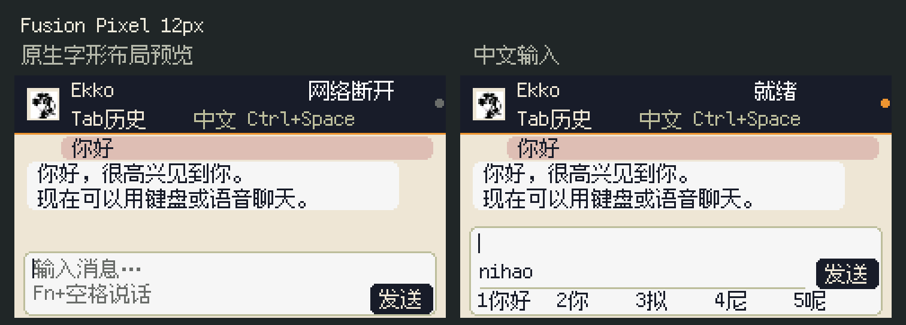

# EkkoStudio for M5Stack Cardputer-Adv

基于 Ekko Studio 原生 ESP32 固件的 **Cardputer-Adv / ESP32-S3 / 8MiB** 适配：原厂菜单与 EkkoStudio 共存，16 个 Agent，键盘中文输入、聊天记录、Fn＋空格语音、原生设备管理及远程连接。不是 M5Stack 或 Ekko 官方发布的设备固件。

当前版本 **v8.2.4.1 · Fusion Pixel 原生 12px**。菜单、正文、输入、候选和状态统一12px，顶部显示「中文 Ctrl+Space」。开发样机已经过烧录、完整闪存读回，样机持有人确认显示正常。

## 下载与安装

[Release 下载](https://github.com/thursdaycapital/ekko-cardputer-adv/releases/tag/v8.2.4.1) · [中文安装教程](安装教程.zh-CN.md) · [首次配网与绑定](安装教程.zh-CN.md#6-首次配网和绑定电脑)

| 用途 | 文件 | 地址 | 设置 |
|---|---|---|---|
| 已安装本项目同布局双固件，更新Ekko | `firmware/ekko-update-0x10000.bin` | `0x10000` | 保留 |
| 同型号新机或明确清空后重装 | `firmware/first-install-dual-8MiB-0x0000.bin` | `0x0000` | 清除 |

**新空NVS完整首刷组合仅完成离线检查，尚未实机首启验收，因此本次标为预发布。** 使用前先确认型号、备份并选择正确方式。两套应用分别已有运行证据不替代空白整机首启测试。

## 电脑端要求

本仓库提供设备固件、板级源码和重建材料，不包含电脑Studio安装包。当前打字聊天／16 Agent路由使用Agent ACK与`chatProtocol:1`扩展；已测试本地配套环境为`0.7.36-cardputer.5`，**不承诺任意未适配的官方原版Studio直接兼容**。各Agent仍需在电脑配置好CLI、账号和模型。具体协议见[板级说明](source/ekko-cardputer-adv/README.md)。

远程需要电脑开机联网、Studio/Agent可用、中继已开启且已完成首次绑定。之后可在能访问中继的2.4GHz网络复用绑定；网络超时、公共Wi-Fi网页认证或账号凭据撤销仍需相应处理。

## 源码与构建

- [Ekko板级源码](source/ekko-cardputer-adv/)，PlatformIO固定依赖。
- [原厂菜单适配源码](source/factory-cardputer-adv/)，独立ESP-IDF5.4.2 app。
- [Arduino对应库源码](source/arduino-esp32-2.0.17/)、[构建与重新链接说明](RELINK.md)。
- [第三方许可](THIRD_PARTY_NOTICES.md)、[隐私说明](docs/PRIVACY.md)、[验证边界](evidence/first-install-offline-validation.json)。

```sh
uvx --from platformio pio run -d source/ekko-cardputer-adv -e cardputer-adv
```

重建生成的Ekko app写入`0x10000`。不要直接以原厂工程的`idf.py flash`替代本双固件安装方法。



预览来自真实字形与绘制指令，非设备拍照。应用SHA256：`1840130458d4329a055f5981b76ec9805958e0f6191ccccfaacd634cf4923e4f`。全部文件见`SHA256SUMS.txt`。

## 来源与许可

Ekko基于[EKKOLearnAI/ekko-studio](https://github.com/EKKOLearnAI/ekko-studio)，原厂基于[M5Cardputer-UserDemo](https://github.com/m5stack/M5Cardputer-UserDemo)的CardputerADV分支。Ekko来源为BSL1.1，保留其非商业Additional Use Grant与变更条款；独立原厂应用及第三方库/字体遵循各自许可，不以一张MIT覆盖。详见[LICENSE](LICENSE)与[第三方许可说明](THIRD_PARTY_NOTICES.md)。商标、头像及素材来源见对应manifest，不表示上游背书。
